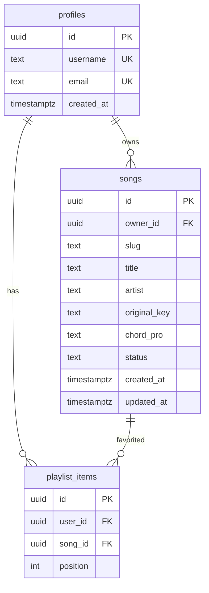

# Phase 2: Auth, songs CRUD, playlist

Continues from [Chord viewer POC](.cursor/plans/chord_viewer_poc_5dd46de0.plan.md). Keep the existing ChordPro parse/transpose/viewer UI; replace in-memory [`src/lib/songbook/songs.ts`](src/lib/songbook/songs.ts) with Supabase-backed data. Seeded songs are **not** loaded into the DB; keep a sample ChordPro file in-repo for reference (and future manual seed scripts).

## Locked decisions

- Public URLs: `/songs/$username/$slug` (unique per author)
- Empty DB at launch; sample file only for format reference
- Auth: signup collects username + email + password; email verification is **optional** (not required to use the app)
- Password reset is supported **only after** the user verifies email; show a clear UX note when unverified
- One favorites playlist per user (ordered list of published songs from any author)
- Home: A–Z letter chips + text search over published songs
- Drafts: owner-only; published: readable by anyone (logged in or not)
- Guests: browse/view/search only — no CRUD, no playlist

## Env (document in `.env.example`)

Required:

- `VITE_SUPABASE_URL` — project URL
- `VITE_SUPABASE_ANON_KEY` — public anon key (browser + SSR with user session)

Server-only (never `VITE_`):

- `SUPABASE_SERVICE_ROLE_KEY` — migrations/seed scripts and privileged server ops only; not used in the browser

Also document Supabase Dashboard settings:

- **Confirm email: OFF** (or equivalent so signup can sign in immediately without verifying)
- Configure Auth email templates + Site URL / redirect URLs for optional confirm + recovery links (`/auth/callback` or dedicated confirm/reset routes)

## Auth model

Signup form fields: **username**, **email**, **password**. Verification is not required to sign in or use CRUD/playlist.

1. Validate username (`^[a-z0-9_]{3,20}$`, unique in `profiles`) and a normal email format
2. `signUp` with the real email + password
3. Insert `profiles` row (`id` = `auth.users.id`, `username`, `email` mirrored for login lookup)
4. On signup success UI: short note that verifying email is optional, but **without verification there is no password-reset option**

Login: **username or email** + password. If the identifier has no `@`, resolve `profiles.username` → `profiles.email`, then `signInWithPassword`.

**Optional verify:** logged-in user can trigger `resend` / confirm link; after click, `email_confirmed_at` is set. Soft prompt in account/nav when unverified (not a blocker).

**Password reset:**

- `/forgot-password`: request reset by email via `resetPasswordForEmail`
- `/reset-password` (or callback): set new password when recovery session is present
- Gate or clearly disable reset when the account email is unverified; copy: *If you have not verified your email, password reset is unavailable—verify first (optional for normal use).*
- Login page links to forgot-password with the same note for unverified users

Packages: `@supabase/supabase-js` (+ SSR cookie helpers as needed for TanStack Start). Clients under `src/lib/supabase/` (browser + server).

## Schema + RLS

- `songs.status`: `draft` | `published`
- Unique `(owner_id, slug)`; slug derived from title (editable), URL-safe
- RLS:
  - `profiles`: public read (for usernames in URLs/lists); users update own row
  - `songs`: anyone can `SELECT` where `status = published`; owners full CRUD on own rows (including drafts)
  - `playlist_items`: owner-only CRUD; insert only allowed when target song is `published`

SQL migrations in `supabase/migrations/`. Optional later: `scripts/seed-from-chordpro.ts` using the sample file + service role (not run by default).

## Sample reference file

- Add e.g. [`samples/adonai.chordpro`](samples/adonai.chordpro) (or `.cho`) with the format [`parseChordPro`](src/lib/songbook/parse.ts) already understands
- Remove runtime dependency on in-repo `SONGS` array; index starts empty until users publish
- Keep a short note in README pointing at the sample + env vars

## App routes / UI

| Route | Access | Purpose |
|-------|--------|---------|
| `/` | public | Published list: text search + A–Z filter (title first letter); show title, artist, author username, key |
| `/login`, `/signup` | guest | Signup: username + email + password + note on optional verify / no reset if unverified; login: username or email + password |
| `/forgot-password`, `/reset-password`, auth callback | guest / recovery | Password reset (works after email verified); optional confirm-email redirect |
| `/songs/$username/$slug` | public (published) / owner (draft) | Existing viewer; playlist hover sidebar when logged in |
| `/songs/new`, `/my/songs`, `/songs/$username/$slug/edit` | auth (owner for edit) | Create/edit ChordPro body + meta + draft/published; export |
| Logout | auth | Clear session |

Replace [`src/routes/songs.$slug.tsx`](src/routes/songs.$slug.tsx) with `songs.$username.$slug.tsx`. Wire loaders to Supabase instead of `getParsedSong` from seeds.

**Editor:** textarea for ChordPro + fields for title/artist/key/slug/status; live parse preview optional if cheap; validate with existing parser before save.

**Export:** download current song’s `chord_pro` as `{slug}.chordpro` (owner’s songs from edit/my songs).

**Playlist sidebar (viewer):** desktop hover (or focus) reveals a left/right rail listing the user’s favorites with links to switch songs; touch: explicit open control (no hover). Add/remove favorite from viewer when logged in and song is published.

**Chrome:** light auth/nav in root or index/viewer toolbar (login, my songs, logout)—guests still see the public catalog and song pages.

## Data layer changes

- Replace [`listSongs` / `getParsedSong`](src/lib/songbook/songs.ts) with async Supabase queries (`listPublishedSongs`, `getSongByUsernameSlug`, owner CRUD, playlist helpers)
- Extend list types with `username`, `status`, `id` as needed; keep parsing/transpose/paginate untouched
- Home search: client filter on loaded published list for POC scale (title/artist/username); A–Z chips filter by title’s first letter (`#` for non A–Z)

## Explicitly out of Phase 2

- Required (blocking) email verification; magic link / OAuth login
- Multiple named playlists
- Collaborative editing, comments, likes counts
- Automatic DB seed of Phase 1 songs (sample file + optional future script only)
