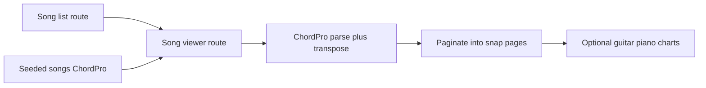

# Chord viewer POC (GitHub)

Recovered from Cursor Origin cloud agent [User song arrangements](https://cursor.com/agents/bc-15d843d3-cacd-489e-9112-961f993d866c) (plan id `chord_viewer_poc_b2fe9faa`). The Origin repo is empty; this workspace already remotes to **GitHub** [roycechua/open-songbook](https://github.com/roycechua/open-songbook). Implement Phase 1 there.

## Locked Phase 1 scope

Viewer-only proof of concept—**no accounts, no song editor**. Auth and per-author arrangements stay for a later phase.

- **Stack:** TanStack Start (same family as royce-website: Vite, React 19, file routes)
- **Data:** Seeded song list in-repo (TypeScript/JSON + ChordPro bodies)—no DB
- **Markup:** ChordPro-like — chords in `[Am]` above lyrics; section directives like `{start_of_chorus}`
- **Key:** Transpose UI relative to the song’s original key
- **Modes:** Chords+lyrics and lyrics-only
- **Charts:** Optional guitar fretboard + piano voicing for chords on the current page
- **Print:** Print stylesheet / print button for the current view
- **Navigation:** Mobile/tablet-first; **horizontal page snap** (one viewport per snap) so vertical fling cannot skip past content
- **Reference UX:** Chord sheet like [bwcsp Adonai](https://bwcsp.weebly.com/adonai.html) / Ultimate Guitar (chords above lyrics, section labels)

## Architecture

- Routes: `/` song index; `/songs/$slug` viewer with state for key, mode, charts, page
- Core libs under `src/lib/songbook/`: parse ChordPro, transpose tokens, split into horizontal pages, chord diagram helpers
- Seed 3–5 songs (including one Adonai-style sheet) so the POC works offline

## Explicitly out of Phase 1

- Sign up / login / Supabase (or any auth)
- Create/edit song UI
- Multi-author same-title versions (future: uniqueness on title + author)

## Delivery target

- Commits and pushes go to **GitHub** `roycechua/open-songbook` (not Cursor Origin)
- Scaffold greenfield app in this empty local clone