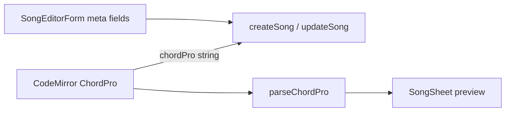

# Enhanced ChordPro source editor

Replace the raw textarea in [`SongEditorForm`](src/components/SongEditorForm.tsx) with a **CodeMirror 6** ChordPro source editor plus a **live preview** pane. Storage/export stay plain ChordPro strings (no HTML / no schema change).

## Locked decisions

- Editor model: **enhanced ChordPro source** (option 2), not a visual chord-above-lyrics editor
- Library: **CodeMirror 6** (`@codemirror/view`, `@codemirror/state`, `@codemirror/lang-*` as needed, custom ChordPro language support)
- Preview: reuse [`parseChordPro`](src/lib/songbook/parse.ts) + existing sheet rendering ([`SongSheet`](src/components/SongSheet.tsx) / [`ChordLine`](src/components/ChordLine.tsx))
- Metadata fields (title, artist, key, slug, status) stay as form controls; editor body is `chordPro` only
- Optional “Source / Preview / Split” toggle; default **split** on desktop, **source-first** with preview tab on narrow screens

## 1. ChordPro language support

Add `src/lib/songbook/chordpro-language.ts` (or under `src/components/editor/`):

- Highlight: directives `{…}`, chord brackets `[Am]`, comments, section markers
- Autocomplete:
  - Directives the parser already understands (`title`, `artist`/`subtitle`, `key`, `start_of_*` / `soc`/`sov`/…, `end_of_*`, `comment`)
  - Common chord roots/suffixes when typing inside `[` … `]`
- Lightweight lint markers (non-blocking): unmatched brackets, unknown directive names (warn only)

Keep highlighting aligned with what [`parse.ts`](src/lib/songbook/parse.ts) accepts—don’t invent unsupported ChordPro features.

## 2. Editor component

Add [`src/components/ChordProEditor.tsx`](src/components/ChordProEditor.tsx):

- Controlled `value` / `onChange` string API matching today’s textarea
- Theme tokens matching app CSS (`--ink`, `--surface`, `--chord`, `--accent`, IBM Plex Mono for chords/code)
- Sensible editing: line wrapping, tab size 2, accessible focus outline
- Mobile-friendly height (min height + grow); avoid horizontal page scroll

## 3. Live preview

Add [`src/components/ChordProPreview.tsx`](src/components/ChordProPreview.tsx):

- `useDeferredValue` on source for typing performance
- Parse → render section headers + `ChordLine` rows (same visual language as the viewer, **no** full paginate/toolbar in the editor)
- Empty / parse-empty state with short hint and link to [`samples/adonai.chordpro`](samples/adonai.chordpro) format
- Sync meta preview: if body lacks `{title}`/`{key}`, show form title/key as preview chrome (optional small header)

## 4. Wire into SongEditorForm

In [`SongEditorForm.tsx`](src/components/SongEditorForm.tsx):

- Replace `<textarea className="song-form__chordpro">` with `ChordProEditor`
- Layout: split pane (editor | preview) with CSS; stacked tabs on small screens (`Source` / `Preview`)
- Keep Export / Save / Cancel behavior unchanged (`downloadChordPro`, BusyButton save)
- “Insert snippet” toolbar above editor: Verse / Chorus / Bridge / Intro wrappers and a chord placeholder `[C]`—insert at cursor via CodeMirror dispatch

## 5. Styles + deps

- `npm install` CodeMirror 6 packages only (no TipTap/ProseMirror)
- Styles in [`src/styles.css`](src/styles.css): `.chordpro-editor`, `.chordpro-preview`, split/tab layout; match existing song-form spacing

## 6. Out of scope

- Visual WYSIWYG chord-above-lyrics editing (option 1)
- Changing DB schema or export format
- Collaborative editing / history
- Full ChordPro 5 / `{define}` / MIDI features

## Verify

- Open edit on an existing song: source loads, highlighting works, preview matches viewer content for the same body
- Type chords/directives: autocomplete appears; preview updates without blocking typing
- Save + export still produce valid ChordPro consumed by the public viewer
- Narrow viewport: tab switch between source and preview works
