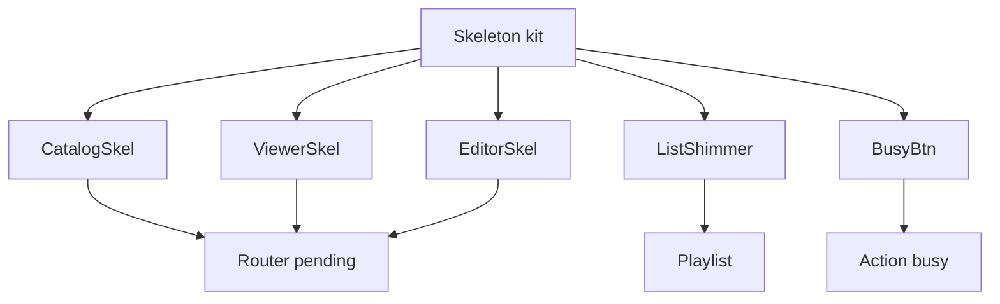

# Loading states polish

Scope: page navigations **and** action busy states, plus **full-page skeletons**, **shimmer lists**, and related best practices.

## Approach

Build a small skeleton/shimmer system that mirrors real layouts (catalog list, my songs, song viewer, editor), wire TanStack Router `pendingComponent`s, and upgrade action buttons to consistent busy affordances. Prefer structure over a lone centered spinner for known pages.

## Best practices locked in

- **Match layout:** skeletons mirror header / filters / list rows / toolbar / sheet so content doesn’t jump when data arrives
- **Delay flash:** `defaultPendingMs` ~150–200ms so fast navigations skip the pending UI
- **Shimmer + reduced motion:** CSS shimmer animation; under `prefers-reduced-motion: reduce`, use a static muted fill (no sliding gradient)
- **A11y:** pending regions `aria-busy="true"`; decorative skeletons `aria-hidden`; `role="status"` / visually hidden “Loading” text; busy buttons `aria-busy` + `disabled`
- **Progress cue:** thin top bar (indeterminate) while router `status === 'pending'` so skeleton pages still feel “in progress”
- **Actions stay in place:** BusyButton keeps button width stable (min-width / spinner + label) to avoid CLS
- **No fetch redesign:** loaders stay as-is; this is presentation only

## 1. Shared UI kit

New components under `src/components/loading/` (or flat `src/components/` if preferred for consistency with existing files):

- `Spinner.tsx` — small/medium sizes
- `BusyButton.tsx` — wraps button; busy → spinner + label, `disabled`, `aria-busy`
- `Shimmer.tsx` / `SkeletonBlock.tsx` — rounded blocks with shimmer class
- `SongListSkeleton.tsx` — brand/header placeholders + filter chip row + **N shimmer list rows** (title + meta lines)
- `SongViewerSkeleton.tsx` — toolbar strip + multi-line sheet blocks
- `SongEditorSkeleton.tsx` — form field bars + large textarea block + actions

CSS in [`src/styles.css`](src/styles.css):

- `.spinner`, `.busy-button`, `.skeleton`, `.skeleton--text`, `.skeleton--title`, `.shimmer` keyframes
- `.route-progress` fixed top indeterminate bar
- `@media (prefers-reduced-motion: reduce)` disables shimmer slide / spinner spin (or slows to opacity pulse)

## 2. Route pending (full-page skeletons)

Today [`src/router.tsx`](src/router.tsx) has no pending UI.

- Set `defaultPendingMs: 150` (or 200) on the router
- Set a **fallback** `defaultPendingComponent` (generic page shell: header + a few blocks) for routes without a custom one
- Per-route `pendingComponent`:
  - [`src/routes/index.tsx`](src/routes/index.tsx) → `SongListSkeleton` (catalog)
  - [`src/routes/my.songs.tsx`](src/routes/my.songs.tsx) → `SongListSkeleton` variant with action-column placeholders
  - [`src/routes/songs.$username.$slug.tsx`](src/routes/songs.$username.$slug.tsx) → `SongViewerSkeleton`
  - [`src/routes/songs.new.tsx`](src/routes/songs.new.tsx) + [`songs_.$username.$slug.edit.tsx`](src/routes/songs_.$username.$slug.edit.tsx) → `SongEditorSkeleton`
- Auth routes stay light (client forms); no heavy page skeleton required
- Root [`AppNav`](src/components/AppNav.tsx) remains visible (pending replaces `<Outlet />` content only)

### Top progress bar

- Small client component in root (e.g. `NavigationProgress`) using `useRouterState` → show `.route-progress` when `isLoading` / `status === 'pending'`
- Sits above content; does not replace skeletons

## 3. Shimmer lists (in-page)

- [`PlaylistSidebar.tsx`](src/components/PlaylistSidebar.tsx): replace “Loading…” with 4–6 compact shimmer rows matching favorite link layout
- Reuse list-row shimmer inside `SongListSkeleton` so catalog/my-songs pending matches final `.song-list` spacing from [`src/styles.css`](src/styles.css)

## 4. Action busy states

| Place | Change |
|-------|--------|
| Auth forms ([`login`](src/routes/login.tsx) / [`signup`](src/routes/signup.tsx) / [`forgot-password`](src/routes/forgot-password.tsx) / [`reset-password`](src/routes/reset-password.tsx)) | BusyButton + existing labels |
| [`SongEditorForm.tsx`](src/components/SongEditorForm.tsx) | BusyButton on save |
| [`AppNav.tsx`](src/components/AppNav.tsx) | Busy on log out / resend verify |
| [`ViewerToolbar.tsx`](src/components/ViewerToolbar.tsx) | Compact spinner on favorite while `busy` |
| [`my.songs.tsx`](src/routes/my.songs.tsx) | Per-row busy on export/delete for `busyId` |

## 5. Explicitly out of scope

- Changing Supabase loaders / caching strategy
- Optimistic UI for favorites (can be a later pass)
- View Transitions API

## Verify

- Slow network (throttle): home / my songs / song / edit show matching skeletons after ~150ms, not a blank flash on fast loads
- Playlist open while fetching: shimmer rows, then real links
- Auth/save/favorite: spinner in-button, no width collapse
- `prefers-reduced-motion`: no sliding shimmer
- Screen reader: status/busy announcements without reading every skeleton block
